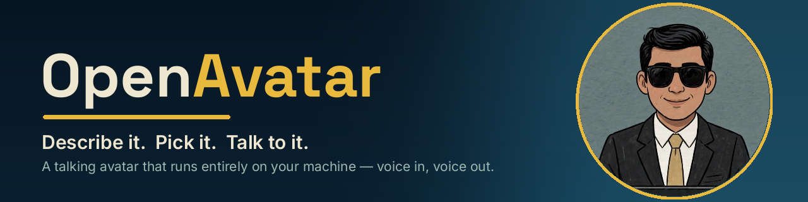
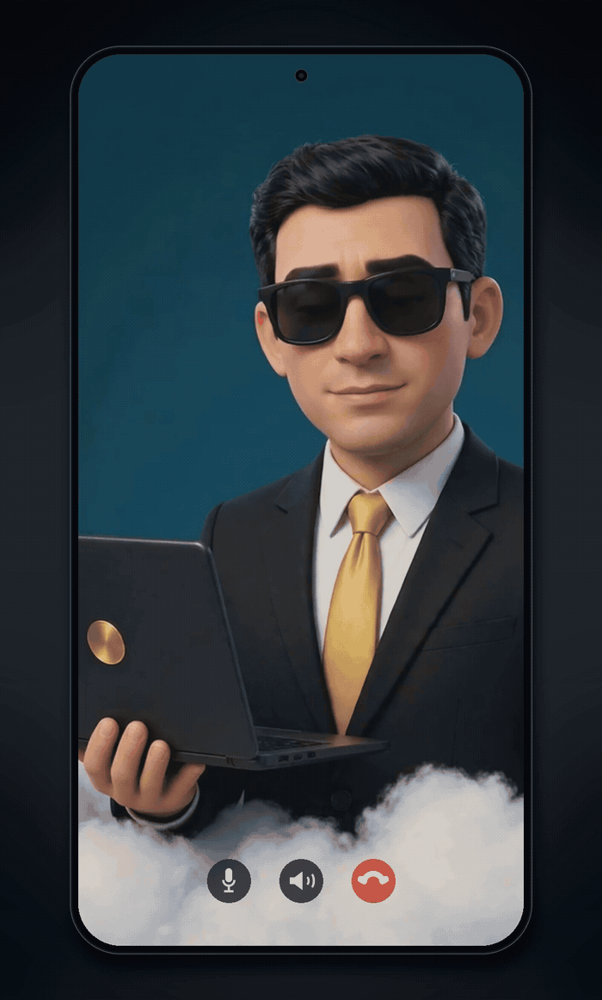
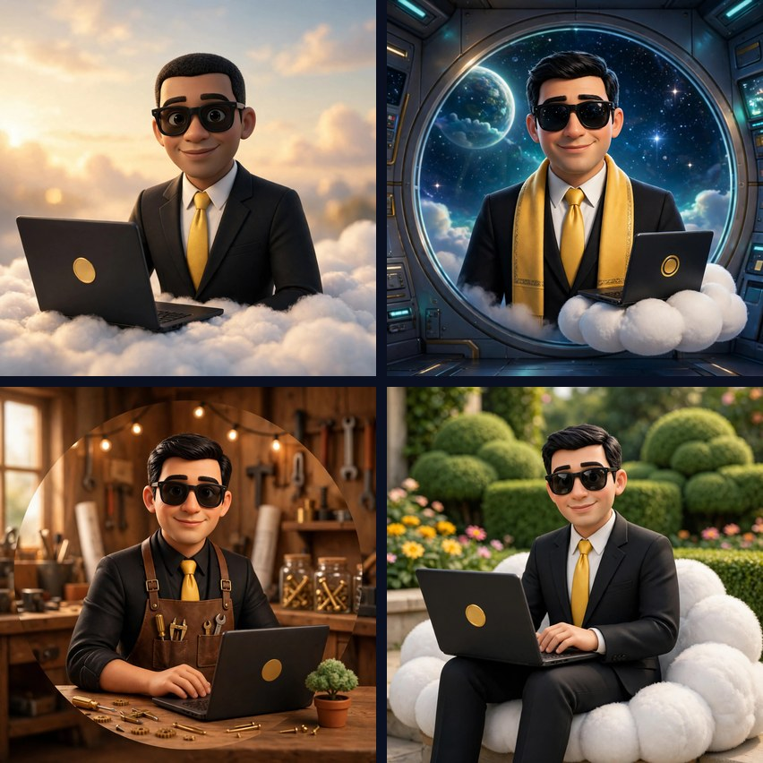

<p align="center">
  
</p>

<h1 align="center">OpenAvatar</h1>

<p align="center">
  <strong>Describe an avatar. Get four options. Pick one. It talks back.</strong><br>
  A local-first talking avatar — ears that hear you, a brain that answers, and a mouth that speaks while the face moves. No cloud calls anywhere.
</p>

<p align="center">
  
  
  
  
  
</p>

<p align="center">
  
</p>

## Demo

<p align="center">
  
</p>

Open the app and the avatar is already alive on stage — idly floating, thinking, listening. Talk to it three ways:

- **🎙 Talk** — press, speak, press again. Your browser records the mic; OpenAvatar transcribes it, answers, and speaks the reply while the avatar's face moves with the actual audio.
- **Type to talk** — the text box always works, no microphone needed.
- **Synthetic ear** — feed any spoken audio file (WAV/MP3/WebM) through the exact same ears pipeline. This is how the bench is tested without a microphone.

## The Avatar Studio — "change my avatar"

The flow is modeled on how this project's own avatar was made: **ask → get options → pick one.**

<p align="center">
  
</p>

1. Click **🎭 Change my avatar**.
2. **Describe** your avatar ("a sharp agent in space, gold and teal") and hit **Generate 4 options** — or **upload a picture**.
3. Four options appear. **Click one** → it becomes the talking face immediately, and the pick persists across restarts.

**Generator honesty:** a local bench server has no route to a real image model, so the built-in generator is a stand-in composer (`studio.py`): it reads the description's keywords — scenes (space, city, sunset, beach, forest, mountain, neon, studio), colors, light/dark — and composes four genuinely different options from the house avatar art. The production studio plugs an image model into the **same slot**: same request (`POST /avatar/generate {"description": ...}`), same four-option response shape. The **upload path is fully real**: your picture becomes an option as-is.

## How it works

| Piece | What it is | Where it comes from |
|---|---|---|
| **Face** | `avatar.jpg` + `index.html` — idle sway, thinking pulse, amplitude-driven talk animation (mouth shadow + head bob + halo glow, driven by the reply audio via WebAudio), plus a 2.5D depth presentation: pointer-parallax tilt, a soft glow behind the character, and a grounded shadow that shifts against the tilt | 3D-style generated portraits of the house character (sunglasses, black suit, gold tie, laptop, cloud). The original flat illustration is kept as `avatar-legacy.jpg` |
| **Ears** | faster-whisper (tiny, CPU, int8), `POST /hear` | One recognizer configuration, shared with the Two Ears test rig — the same path its mic ear and synthetic ear feed |
| **Brain** | Ollama chat, `qwen2.5:0.5b`, persona prompt, short spoken-style replies (they're read aloud), small rolling history | Local Ollama at `127.0.0.1:11434`. Swap with `BENCH_OLLAMA_MODEL` (e.g. `llama3.1:8b` for a deeper persona at more latency) |
| **Mouth** | Piper TTS → WAV, `POST /talk` | Piper binary + voice model, text on stdin, `--output_file`. Default voice **en_US-lessac-medium** |

Server: `server.py` — Python standard library only, loopback-only bind, **port 8899**.

Config via environment: `BENCH_PORT`, `BENCH_WHISPER_MODEL`, `BENCH_OLLAMA_URL`, `BENCH_OLLAMA_MODEL`, `BENCH_PIPER_BIN`, `BENCH_PIPER_MODEL`, `BENCH_TTS_VOICE`, `BENCH_RIG_DIR`.

## Quickstart

Prerequisites: Python 3.11+ and [Ollama](https://ollama.com), with the brain model pulled:

```powershell
ollama pull qwen2.5:0.5b
```

**Windows:**

```powershell
py -m venv .venv
.venv\Scripts\pip install -r requirements.txt
.venv\Scripts\python -m piper.download_voices en_US-lessac-medium
```

Copy the downloaded `en_US-lessac-medium.onnx` + `.onnx.json` into `voices\`, then:

```powershell
run.bat
```

**macOS / Linux:**

```bash
python3 -m venv .venv && .venv/bin/pip install -r requirements.txt
./run.sh
```

Then open **http://127.0.0.1:8899** in Chrome or Edge. `127.0.0.1` counts as a secure context, so the microphone works there. Leave Ollama running.

## Proof

`TEST-LOG.md` — the synthetic-ear loop run end-to-end: Piper-spoken question → exact transcript → brain reply → spoken reply WAV, with timings and honest caveats. Re-run it any time with the server up:

```powershell
.venv\Scripts\python test\run_e2e.py
```

## Honest limits

- **Real microphone proof happens on your machine.** The build sandbox has no audio hardware, and the server never captures a mic by design — the browser does. The page detects a blocked or missing mic and reports it cleanly, falling back to typing or the synthetic ear.
- **The look is 3D-style art with 2.5D presentation — not a real-time 3D model**, and nothing here claims otherwise.
- The talking animation is tasteful, not a redrawn character: mouth shadow + head motion driven by the real reply audio. True lip-sync would need per-phoneme data Piper doesn't emit here.
- The 0.5B brain is fast and format-obedient but generic. Persona depth scales with the model you point `BENCH_OLLAMA_MODEL` at.
- One shared conversation history lives in the server process; restart clears it. No accounts, no persistence beyond the avatar pick — it's a bench.

## What's in this repo

Code, docs, scripts — and the avatar art (`avatar.jpg`, `avatars/*.jpg`, `docs/images/`). Two things stay out by design:

- `voices/*.onnx` — the Piper voice model; restore it with the `piper.download_voices` step above.
- `test/*.wav` — proof recordings; regenerate them with `test/run_e2e.py`.

Runtime output (`avatars/generated/`, `avatars/uploads/`, `state.json`) is created on first use and git-ignored.

## Where this goes next

OpenAvatar is the test-first bench for a companion-face module: the stage and its state classes (idle / listening / thinking / talking) map 1:1 onto a host app's voice states, the ears and mouth are already the shared local voice stack, and the Studio's four-option flow is the in-app "change my avatar" experience. One rule carries over unchanged: anything the avatar is asked to *do* — send, pay, delete, ship — still goes through the host app's approval gate. The bench only talks.

## License

MIT — see `LICENSE`.
