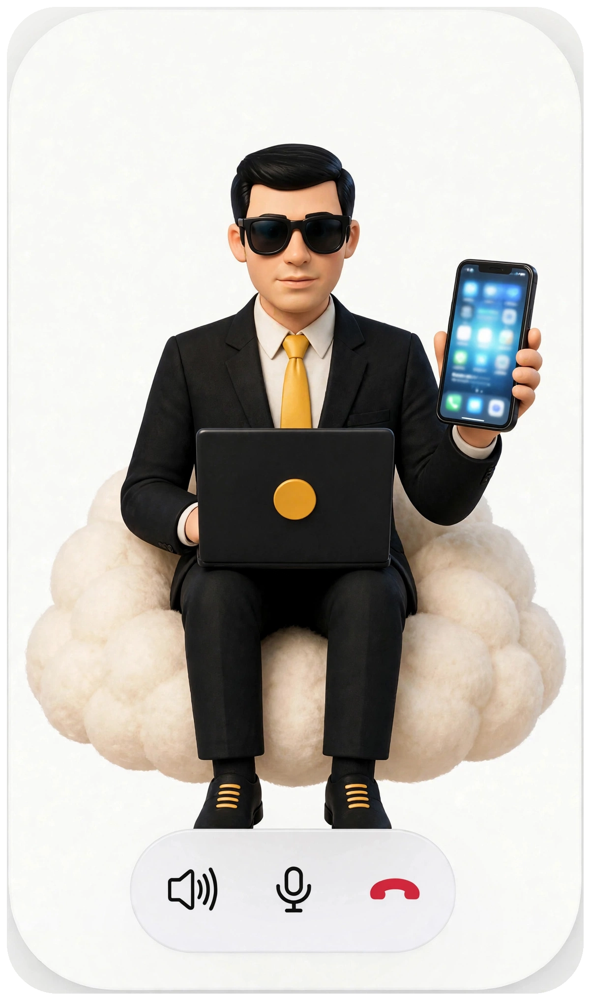
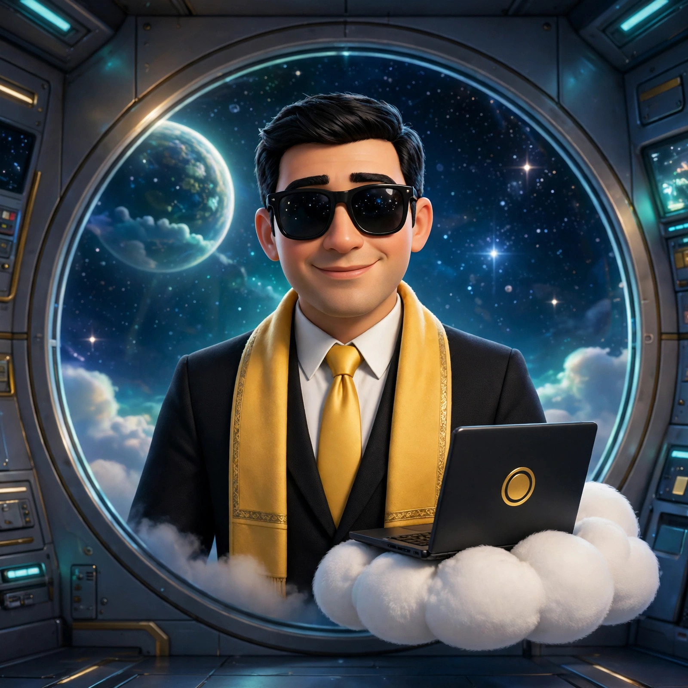
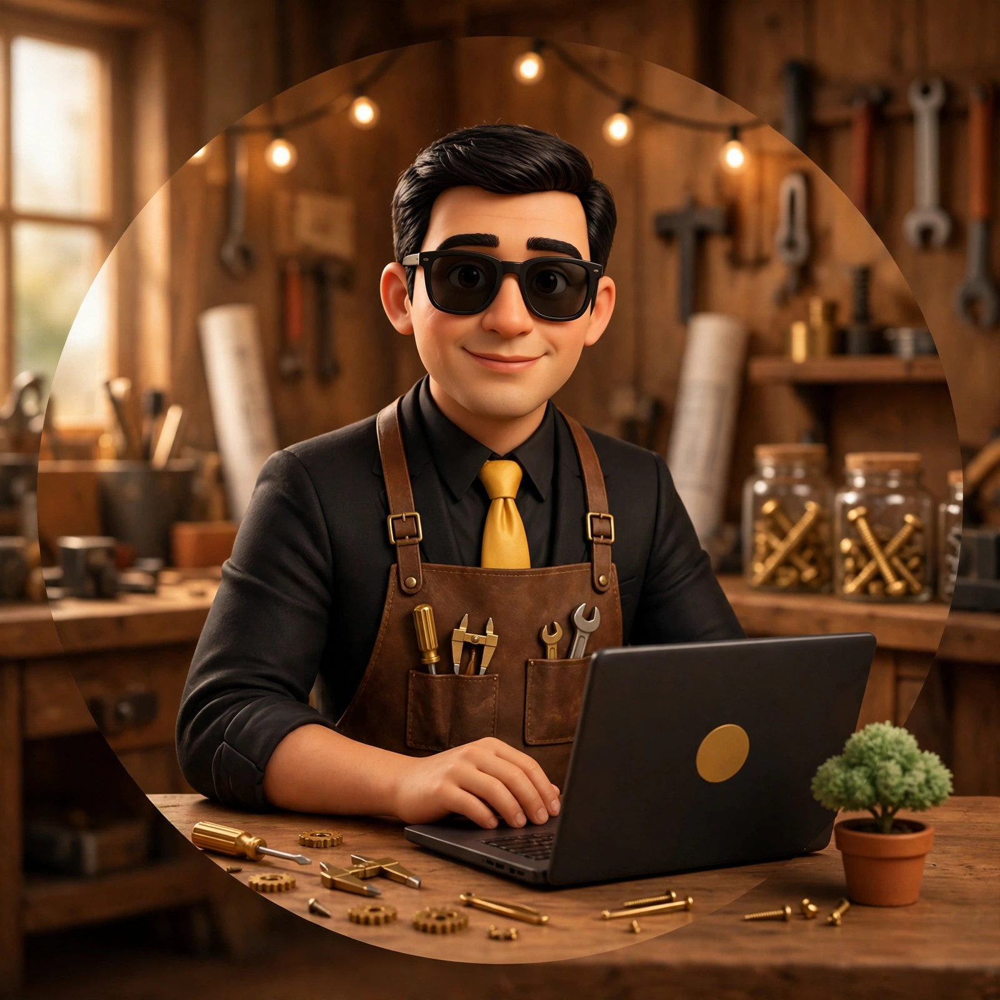
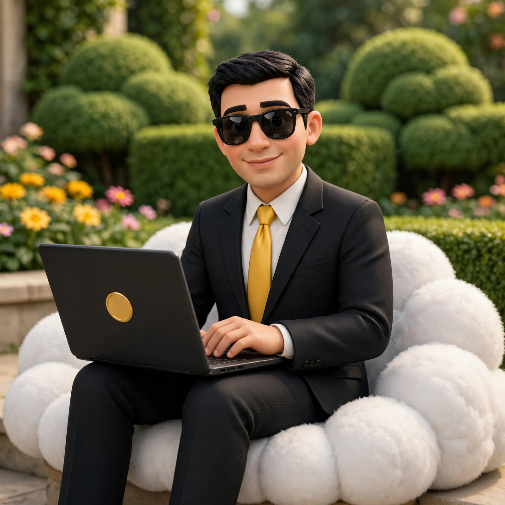
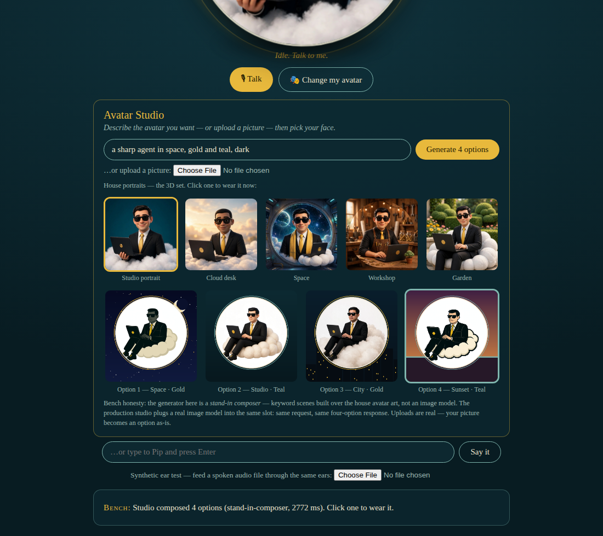

<p align="center">
  
</p>

<h1 align="center">Describe it. Pick your sticker. It talks back.</h1>

<p align="center">
  <strong>OpenAvatar</strong> is a talking avatar you actually converse with. Describe the character you want — or drop in a picture — get <strong>four sticker options</strong>, pick one, and it becomes your avatar: it listens, thinks, and answers out loud. Voice in, voice out, <strong>fully local</strong>. No cloud calls, no account, no keys leaving your machine.
</p>

<p align="center">
  
  
  
  
  
  
</p>

---

<!-- ============================================================
     HERO DEMO SLOT — when the rebuilt phone-call demo lands at
     docs/demo.gif, replace the shot-main.png image directly
     below with the demo. One line changes; nothing else moves.
     ============================================================ -->

<p align="center">
  
</p>
<p align="center"><em>The call window — Pip on the cloud, phone in hand, call bar below. This is the window the bench opens with.</em></p>p>

---

## 🎟️ The sticker pack

Every avatar is a **sticker**: a glossy 3D-style character with a locked look — same face, same outfit language, new scene. The built-in pack:

| | | | | |
|---|---|---|---|---|
|  |  |  |  |  |
| **Studio** (default) | **Cloud** | **Space** | **Workshop** | **Garden** |

Don't like the pack? **Make your own** — the Studio renders four fresh options from your description or your picture, and the one you pick joins the window immediately and stays picked.

## ✨ Pick a sticker → it comes alive

1. **Describe it, or give it a picture.** Type what you want ("a robot barista in a red apron") or upload an image to base it on.
2. **Pick from four.** The Studio renders four sticker options in the house style. Click the one that's *you*.
3. **It comes alive.** Your pick moves into the call window and starts working: ask it something by voice or text, it turns to you and answers out loud — head bobbing, mouth moving with the real audio.

## 🔌 A framework, not just a demo

OpenAvatar is built to **plug into other apps and agent stacks**. The product surface is one embeddable unit — the **Call Window** — driven by a small HTTP API that exists and is proven today:

| Endpoint | What it does |
|---|---|
| `POST /talk` | Text (or a synthetic-ear WAV) in → transcript, reply text, and spoken reply audio out |
| `POST /avatar/generate` | Description in → four sticker options out |
| `POST /avatar/upload` | Your picture in → becomes a selectable option |
| `POST /avatar/pick` | Locks your choice — persisted, everywhere, immediately |
| `GET /health` · `GET /state` | Honest status: which ears, brain, and mouth are actually live |

The full spec — Call Window states, the agent event interface, the sticker standard, and the honest exists-vs-spec ledger — lives in **[FRAMEWORK.md](FRAMEWORK.md)**. The realtime streaming channel and the embeddable component package are **spec, not shipped**, and are labelled that way everywhere they appear.

> **Premium voices** and full talk-back ship as a gated feature of **Robot Orchestra V2** — the open layer in this repo runs the standard local voice (Piper). No pricing or sales copy lives in this repo.

## 🧠 How it works

| Part | Engine | Notes |
|---|---|---|
| **Ears** | faster-whisper (tiny, int8) | Imported from the [Two Ears](https://github.com/EdgeAgent/two-ears-one-mouth) rig — one shared recognizer config, reported honestly by `/health`. Browser mic capture on the page, or feed a WAV to the synthetic ear. |
| **Brain** | Ollama (`qwen2.5:0.5b` by default) | Local LLM with a spoken-style persona and rolling conversation history — typed and spoken lines share one conversation. |
| **Mouth** | Piper (`en_US-lessac-medium`) | The same invocation Robot Orchestra V2's voice server uses — binary + voice model, text on stdin, WAV out. Fast, light, and fully local. |
| **Face** | Sticker portrait + WebAudio | The reply's real audio drives the mouth, head bob, and halo — amplitude-synced, not a looping GIF. Pointer-parallax tilt and a grounded shadow give the still its 3D presence. |

## 🎭 The Studio

<p align="center">
  
</p>

Describe it or upload a picture → four options → click → the face in the window changes *now* and persists across restarts (server state + browser storage). The bench's generator is a **labelled stand-in composer** (keyword scenes over bundled art, deterministic per description) that fills the exact slot a production image model plugs into — same request in, same four options out. The upload path is fully real.

## 🚀 Quick start

**Prerequisites:** Python 3.11+, [Ollama](https://ollama.com) running locally with a small model pulled (`ollama pull qwen2.5:0.5b`), and the [Two Ears](https://github.com/EdgeAgent/two-ears-one-mouth) rig cloned next door (the ears import from it; a same-config local fallback exists and `/health` tells you which one is live).

```bash
# Windows
run.bat

# macOS / Linux
./run.sh
```

Then open **http://127.0.0.1:8899** — loopback only, nothing exposed. Type to talk, use the mic button for your browser microphone, or POST a WAV to `/talk` to drive the synthetic ear.

## ⚠️ Honest limits

- **The Studio generator is a stand-in**, labelled in the UI, the README, and `/health`. Production swaps in a real image model behind the same interface.
- **Real-microphone proof happens on your machine.** This bench was built in a sandbox with no audio hardware — mic capture is browser-side by design and the code reports "no microphone" cleanly instead of faking it. First physical-mic proof is on a real Windows machine.
- **3D-style stills, not a real-time 3D model.** The presence comes from layered 2.5D presentation over generated portraits.
- **Small local brain.** The default 0.5B model keeps replies short and spoken-style; it is a conversation partner for the bench, not a reasoning engine. Point Ollama at a bigger model if you want more.
- **The demo recording** for this README is being rebuilt (a live phone-call-style capture); the screenshots above are the current visual proof — real captures of the running bench, not mockups.

## 🗺️ Roadmap

- [ ] Live phone-call demo at the top of this README
- [ ] Kevin's Windows test: physical mic, full conversation, Studio pick end-to-end
- [ ] Production image model in the Studio generator slot
- [ ] Realtime streaming channel + embeddable Call Window package (per FRAMEWORK.md spec)
- [ ] Lift into the **Robot Orchestra V2** chat window — only after the standalone test passes

## 📄 License

MIT — see [LICENSE](LICENSE). © Kevin Doherty.

---

<p align="center"><em>OpenAvatar is the open framework and bench. Its premium voices and full talk-back ship inside Robot Orchestra V2.</em></p>
